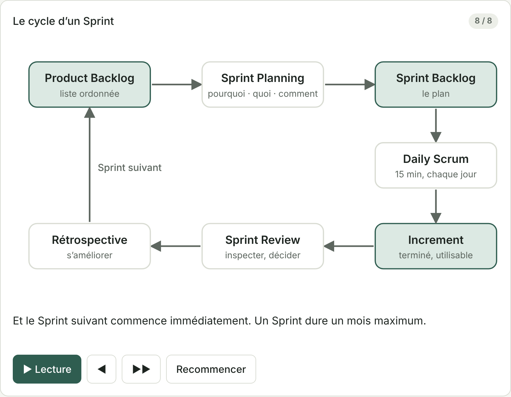
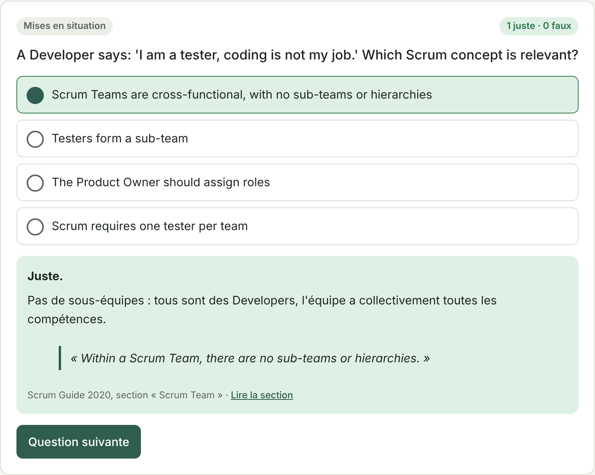
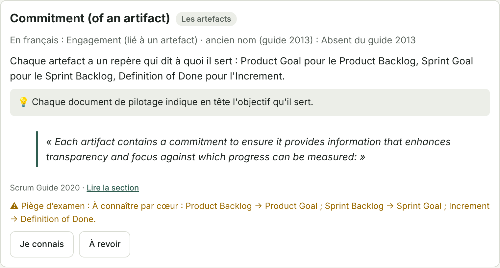

# Sabrina Heydel

### AI Product Builder · Full-Stack Digital Systems

**I turn complex business processes into simple, connected and measurable digital products.**

From product discovery and UX to data, APIs, automation, QA, analytics and deployment.

---

## What I build

| Focus | Examples | Outcome |
|---|---|---|
| **AI Products** | Copilots, intelligent interfaces, AI-ready workflows | Faster decisions and better user experiences |
| **Digital Systems** | CRM, dashboards, portals, internal tools | One clear operational layer |
| **Automation** | APIs, workflows, data flows, connected actions | Less repetitive work and fewer handoffs |
| **Client & Learning Experiences** | Booking, training spaces, client portals | More structured delivery and follow-up |
| **Product Strategy** | Discovery, UX, architecture, delivery | Technology aligned with real business needs |

> **Every project starts with a business problem.**  
> Not with a technology.

`Business problem → Product discovery → UX → Architecture → Build → Automate → Measure`

---

## Selected work

### 01 · TalentFlow AI

**AI-assisted recruitment workspace** designed to turn fragmented recruiting workflows into one clear decision environment.

**Problem**  
Recruitment teams often manage candidate information, interviews, feedback and follow-up across disconnected tools, creating context switching and poor visibility on priorities.

**Product**  
A bilingual recruitment workspace combining pipeline visibility, candidate decision support, interview coordination, guided demo flows, feedback and product analytics.

**My role**  
Product discovery · Workflow analysis · UX/UI · Front-end architecture · AI-assisted development · QA · Analytics instrumentation · Deployment

**Core stack**  
Next.js · React · TypeScript · PostHog EU · Webflow Cloud · GitHub Actions

> Portfolio demo using simulated data and AI-ready product architecture. No real candidate data is processed.

### 02 · Real Estate Platform & CRM

**Full-stack acquisition and CRM product demo** showing how a public website can feed an operational sales workflow instead of stopping at isolated forms.

**Problem**  
Real-estate teams receive demand through listings, calculators, valuation requests and candidate profiles, but those signals are often fragmented and require manual qualification.

**Product**  
A connected system where website interactions can become structured CRM leads with scoring, next actions, appointments, property matching and a secure public demo sandbox.

**My role**  
Business analysis · Product discovery · UX · System design · Data modelling · Supabase/RLS · Server authorization · Automation logic · QA · Demo architecture · Deployment

**Core stack**  
React · TanStack · TypeScript · Supabase · PostgreSQL · RLS · APIs · Brevo · GA4 · GitHub

> Public beta using fictional data, isolated demo roles and simulated sensitive actions.

### 03 · Product Resume

**Bilingual interactive resume built as a small web product**, with responsive UX and recruiter-friendly PDF delivery.

**Product**  
FR/EN web resume, mobile-safe PDF export with clickable links, print-quality Chromium PDFs generated automatically in GitHub Actions and structured case studies for product work.

**My role**  
Product positioning · Information architecture · UX · React/TypeScript implementation · PDF workflow · QA · GitHub automation

**Core stack**  
React · TypeScript · TanStack Start · jsPDF · html2canvas-pro · Playwright/Chromium · GitHub Actions

### 04 · PSPO Coach

**Grounded AI learning coach** built to prepare the Professional Scrum Product Owner I (PSPO I) certification, as a personal study tool.

**Problem**  
Certification prep is usually passive: reading a guide, then taking random practice tests. Learners forget, repeat the same mistakes, and generic AI chatbots can confidently invent rules that are not in the official source.

**Product**  
A bilingual (FR/EN) learning app in which every answer is traceable to the official Scrum Guide 2020:

- **Daily challenge** (about 5 minutes): one animated capsule, three questions targeted at weak spots and one key term, with a day streak
- **6 animated, narrated capsules** and **3 interactive diagrams** (Scrum Team, artifacts and commitments, events timeline)
- **133 questions**: Scrum Guide rules, real-life scenarios and value measurement (Evidence-Based Management), with spaced repetition on mistakes
- **Timed mock exam** (80 questions, 60 minutes, 85% pass mark), **mistake log** and **weekly report**
- **47-term glossary**, a drag-and-drop sorting game and a 2-minute true/false game
- **"Explain it to a sales rep"** mode: the learner explains a concept in their own words (typed or dictated) and the AI scores it against the guide
- **"Ask the guide"**: answers only from the Scrum Guide, with exact quotes, and says *"I don't know"* when the answer is not in the source

**How it is built**  
- One self-contained web page (HTML, CSS, vanilla JavaScript), published as a Claude artifact. No framework, no external backend to maintain.
- A Python build script generates the question bank as JSON and **checks that every quote exists word for word in the Scrum Guide** before publishing.
- Animations and diagrams are hand-built SVG, with keyboard access, light and dark themes and reduced-motion support.
- AI features call Claude with the relevant guide sections as the only context (retrieval-grounded prompting). Every quote the model returns is **verified in the browser against the source text**; unverified quotes are never shown.
- Progress is stored privately per user; speech uses text-to-speech and dictation, with a text-only fallback.

**My role**  
Product discovery · Learning design · UX/UI · Content architecture · Prompt and guardrail design · Front-end development · QA

**Core stack**  
HTML · CSS · JavaScript · SVG · Python · JSON · Claude (Anthropic) · Playwright (QA)

  
  
  

> Private personal tool. Content based on the Scrum Guide 2020 by Ken Schwaber and Jeff Sutherland and the Evidence-Based Management Guide by Scrum.org, both licensed CC BY-SA 4.0.

---

## Core stack

**Product & design**  
  

**Development & data**  
     

**AI & automation**  
    

**Deployment & quality**  
   

**Growth & operations**  
  

<strong>Also working with:</strong> JavaScript · REST APIs · JSON · Webhooks · Framer · Bubble.io · Canva · Perplexity · Mailchimp · Apollo.io · AnswerThePublic · Notion · Stripe · Cal.com · Whop · OVHcloud

---

## How I work

**01. Diagnose** · understand the workflow, friction and business objective  
**02. Design** · define the product, UX and information architecture  
**03. Architect** · choose the appropriate stack, data model, permissions and integrations  
**04. Build** · create the interface, logic and connected workflows  
**05. Ship & measure** · QA, deploy, instrument usage and create a feedback loop

---

## Let's build something useful

### Have a business process that should work better? Let's talk.

I work with businesses, agencies and product teams on digital products, AI-assisted tools, internal systems, automation and client experiences.

